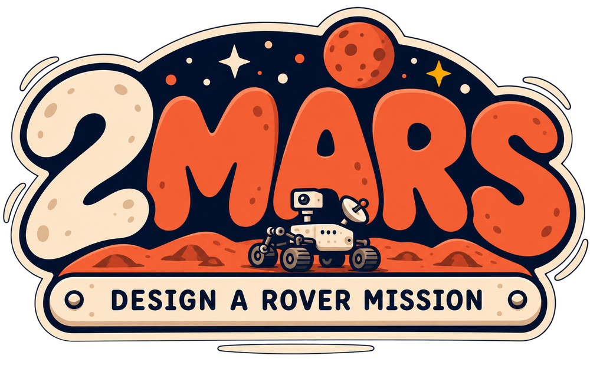

<p align="center">
  
</p>

<h1 align="center">2Mars · V4</h1>
<p align="center"><strong>Design your mission. Operate your rover. Discover Mars.</strong></p>
<p align="center">Current playable version · Godot 4.7 · English / Español</p>

<p align="center">
  <a href="https://2mars.com">Play online</a> ·
  <a href="../../README.md">Repository home</a> ·
  <a href="docs/README.md">Documentation</a> ·
  <a href="docs/SCIENCE_TRACEABILITY.md">Science traceability</a>
</p>

---

## About this version

V4 is the current version of 2Mars. It is an educational mission-design and management game developed by Team SpaceNuts for the NASA Space Apps Challenge 2026.

Players plan a Mars mission, configure a rover, launch, travel to Mars, complete a simplified landing sequence, and conduct scientific operations. Mission planning and engineering choices affect the resources, instruments, risks and science results available later.

### What's included

- **Campaign and Sandbox** modes.
- **Local two-player co-op** with complementary roles: Mission Commander and Rover Engineer & Scientist.
- **Bilingual interface:** English and Spanish.
- **3D presentation:** modular rover model, Martian exploration terrain, Mars globe and mission environments.
- **Mission design:** launch window, mission profile, landing site and science priority.
- **Rover workshop:** about 30 components across seven categories, with engineering trade-offs.
- **Science operations:** seven primary science instruments, target investigation, sample collection, data storage and communications.
- **Mission progression:** upgrades, a Mars base, science inventory, achievements and a structured debrief.
- **Science Library:** real NASA/JPL references, mission stories and an explicit source-to-gameplay traceability section.

2Mars simplifies complex engineering for learning and play. It is not a professional mission-design tool or a high-fidelity orbital simulator.

## Play

### Online

Visit **[2mars.com](https://2mars.com)**.

### Run with Godot

1. Install **Godot Engine 4.7**.
2. Open Godot and choose **Import**.
3. Select this folder's `project.godot`.
4. Open the project and press **F5**.

No extra Godot plugins are required.

### First launch

The game asks the player to select:
- Interface language: English or Spanish.
- Input preference: mouse, keyboard, or both.

These preferences can be changed later in Settings.

## Mission flow

1. **Briefing:** meet Dr. Owen, name the mission and review the six connected constraints.
2. **Earth station:** review the rover, mission status and available resources.
3. **Mission planning:** choose a launch window, mission profile, landing site and science priority.
4. **Workshop:** configure the rover and balance mass, budget, power, mobility and science capability.
5. **Mission readiness:** review blockers, risks and recommendations before launch.
6. **Launch and transit:** make decisions during cruise and follow the simplified entry, descent and landing sequence.
7. **Mars operations:** drive, investigate targets, use instruments, collect samples, store data and transmit results.
8. **Debrief:** review mission performance, consequences and recommendations.

Required objectives complete the mission; optional objectives provide additional science and achievements.

## Controls

| Action | Keyboard | Mouse |
|---|---|---|
| Drive | WASD / arrow keys | Hold the on-screen drive control |
| Study a rock | E | Select the rock |
| Choose / confirm | 1–6 / Enter | Select the option |
| Instrument action | Space | Select the action |
| Transmit data | T | Transmit button |
| Data / AutoNav / Controls | Tab / G / H | Action bar |
| Weather / Oxygen / Radar | M / O / R | Action bar |
| Pause | Esc | Pause button |
| Fullscreen | F11 | — |

### Local co-op

Two players share one computer and take complementary responsibilities:

- **Mission Commander:** drives with the arrow keys, transmits with T and confirms with Enter.
- **Rover Engineer & Scientist:** handles science and rover actions using E, 1–6, Space, M, O, R and G; F confirms.

Some major decisions require both players. A controller mapping exists, but controller support should be considered unverified unless tested on the target device.

### Sandbox

Sandbox offers a separate free-design environment with adjustable mass and budget limits, zone selection, test driving and reset. Sandbox state is separate from Campaign progress and history.

## Testing

The V4 project includes an automated bot and a script compilation test.

Run these commands from the repository root:

```bash
# Compile the project scripts
godot --headless --path Game-versions/V4 res://tests/Compile.tscn

# Run the automated test bot
godot --headless --fixed-fps 60 --path Game-versions/V4 res://tests/Bot.tscn

# Run the bot in Spanish
godot --headless --fixed-fps 60 --path Game-versions/V4 res://tests/Bot.tscn -- --es

# Run the shorter full-mission test
godot --headless --fixed-fps 60 --path Game-versions/V4 res://tests/Bot.tscn -- --quick
```

The bot uses a separate save file and is designed to exercise the actual game flow. The team has also manually played complete game sessions. These internal playtests are not a formal external educational-impact study.

## Project structure

```text
V4/
├── assets/       Fonts, audio, logo and game visuals
├── docs/         Technical documentation and project evidence
├── scenes/       Godot scenes
├── scripts/      Game state, data, UI and gameplay systems
├── shaders/      Visual shaders
├── tests/        Automated test bot and compile test
├── tools/        Capture, preview and asset-generation utilities
├── icon.svg
└── project.godot
```

## Scientific foundation

NASA and NASA/JPL mission documentation—especially the Mars 2020 Perseverance mission—inform the game's science objectives, instruments, rover systems, sample collection, mobility and communications.

The Science Library distinguishes:
- **Real mission facts** supported by NASA/JPL references.
- **Game parameters** used to make mission management playable.
- **Fictional elements** such as Dr. Owen, the player's rover and mission.

Examples of deliberate simplifications include the game's 300 W RTG parameter compared with Perseverance's approximately 110 W MMRTG output at mission start, accelerated communications and time, and simplified landing and mission-planning models.

Read the [NASA resource inventory](../../research/NASA_RESOURCES_USED.md) and [V4 science traceability](docs/SCIENCE_TRACEABILITY.md) for the full source mapping.

## Documentation

The [V4 documentation index](docs/README.md) explains where to find:
- Requirements and rubric mapping.
- Scientific source traceability.
- Resource and media attribution.
- Cinematic and animation notes.
- Development handoff and submission references.

## Credits

**Team:** SpaceNuts · Panama  
**Engine:** Godot 4.7 · GDScript  
**Web deployment:** Vercel  
**Fonts:** Fredoka and Nunito (SIL Open Font License)  
**Visual and development workflow:** see [Resource Audit](docs/RESOURCE_AUDIT.md) for tool-specific attribution.

2Mars is an independent student project and is not affiliated with or endorsed by NASA.
