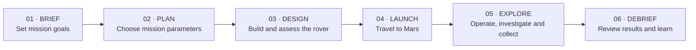
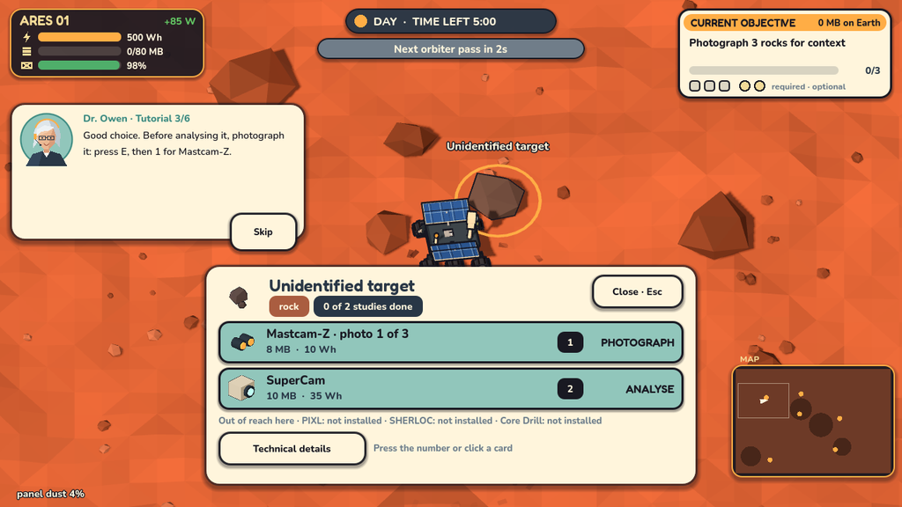
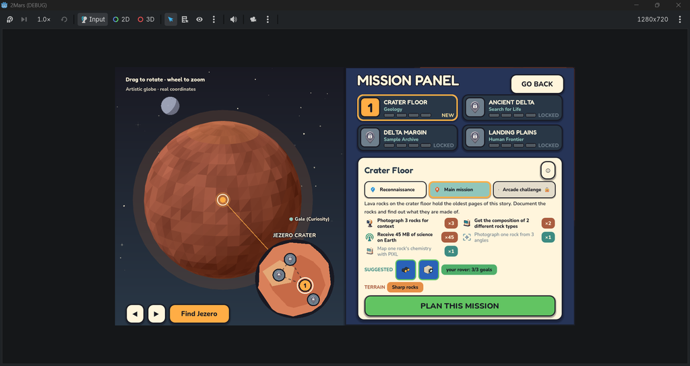
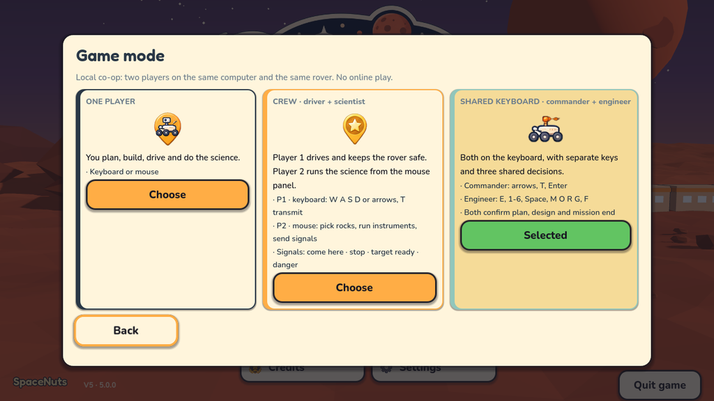
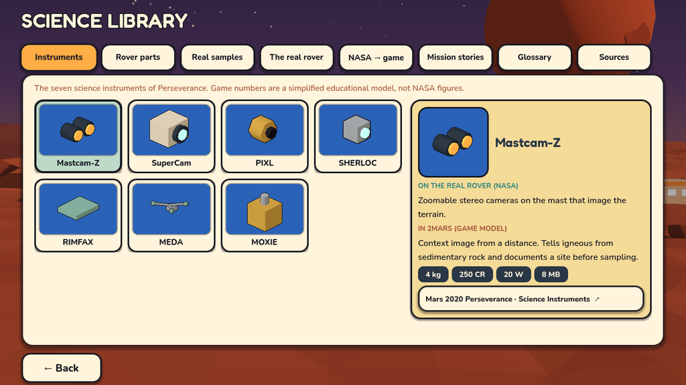
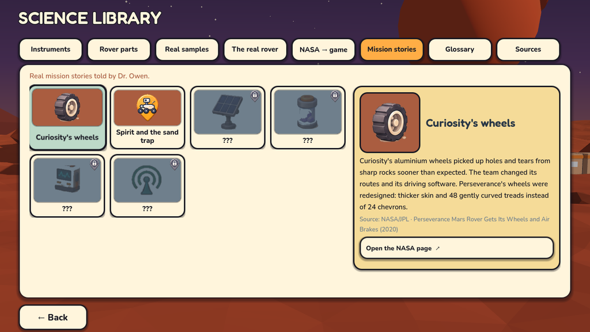

<!-- 2Mars | Team SpaceNuts | NASA Space Apps Challenge 2026 -->

<h1 align="center">2Mars</h1>

<strong>Every decision shapes the mission.</strong>

An educational Mars rover mission design and exploration game by Team SpaceNuts · Panama

---

## Your mission starts here

**2Mars** turns the planning and operation of a Mars rover mission into an interactive experience. Players define scientific priorities, plan a mission, build a rover under engineering constraints, assess readiness, launch, explore the Martian surface, collect evidence and review the outcome.

The rover you design is the rover you operate. Choices about mass, power, mobility, instruments, storage and communications shape what the mission can accomplish.

**[Open the web demo](https://2mars.vercel.app/)** · **[Explore the V5.1 source project](Game-versions/V5/)**

## Gameplay at a glance

## Screenshots

These captures show the V5 game interface and actual gameplay systems.

## What players can do

- **Plan a mission:** choose objectives, a mission profile, launch scenario, landing area and science priorities.
- **Engineer a rover:** select from a 30-component catalogue across seven categories and balance mass, budget, power, mobility, data storage and scientific capability.
- **Evaluate readiness:** identify blockers, risks, limitations and recommendations before launch.
- **Travel to Mars:** experience launch, cruise, landing and mission events through an educational game model.
- **Explore and investigate:** navigate Martian terrain, photograph and analyse targets, collect samples, manage energy and data, and transmit findings.
- **Learn from evidence:** consult the Science Library, real mission stories, glossary and NASA-to-game explanations.
- **Play in English or Spanish:** language and input preferences are available in the game.
- **Play solo or locally with others:** includes single-player and local cooperative options; no online multiplayer is claimed.

## Current source version

**CURRENT SOURCE** **V5.1.0** · Godot Engine 4.7 · GL Compatibility renderer.

V5.1 includes an Expedition co-op mode in which two rovers share one mission through a fixed split-screen view. Each rover has individual position, speed, energy, health and sample tubes; mission time, memory, data, objectives and rewards are shared. See the [V5 player guide](Game-versions/V5/README.md) and [V5 documentation index](Game-versions/V5/docs/README.md).

Older versions remain available as development history; V5 is the current source of truth.

## Project evidence for reviewers

The official NASA Space Apps Project Submission is the entry evaluated by the challenge. This repository complements that submission with inspectable implementation and evidence.

| Evidence | What it documents |
|---|---|
| [Challenge alignment](evidence/CHALLENGE_ALIGNMENT.md) | How gameplay addresses the Space Mission Design Game challenge. |
| [Educational design](evidence/EDUCATIONAL_DESIGN.md) | Concepts, player activities and intended learning opportunities. |
| [Mission walkthrough](evidence/MISSION_CASE_STUDY.md) | A reproducible route through the complete mission flow. |
| [Test report](evidence/TEST_REPORT.md) | V5 automated test assets, coverage and execution limits. |
| [AI and asset attribution](evidence/AI_AND_ASSET_ATTRIBUTION.md) | Team-confirmed production tools and attribution boundaries. |
| [V5 technical documentation](Game-versions/V5/docs/README.md) | Requirements mapping, science traceability, resource audit and references. |

## Run the current source project

1. Install **Godot Engine 4.7**.
2. Clone or download this repository.
3. Import `Game-versions/V5/project.godot` in Godot.
4. Press **F5** to run the project.

No additional Godot plugins are required by the project configuration. For controls and gameplay instructions, read the [V5 game guide](Game-versions/V5/README.md).

## Repository map

| Folder | Purpose |
|---|---|
| [`Game-versions/V5/`](Game-versions/V5/) | **Current source (V5.1.0):** Godot project, scripts, scenes, assets, tests and documentation. |
| [`Game-versions/V4/`](Game-versions/V4/) | Previous playable version, retained for history. |
| [`Game-versions/V3/`](Game-versions/V3/) | Earlier playable version, retained for history. |
| [`Game-versions/V1/`](Game-versions/V1/) | Initial prototype. |
| [`screenshots/`](screenshots/) | V5 visual evidence used above. |
| [`evidence/`](evidence/) | Reviewer-oriented project evidence. |
| [`research/`](research/) | NASA/JPL references and mission-planning research. |

## Scientific grounding and model boundaries

NASA and NASA/JPL mission documentation informs the science objectives, rover systems, instruments, samples, communications and mission stories represented in 2Mars. The in-game Science Library links selected references to gameplay.

2Mars is an educational game, not professional mission-design software. It does not calculate real orbital trajectories or Delta-V, connect to live NASA APIs, or directly load NASA planetary datasets. Several quantities and mission outcomes are simplified game parameters; fictional elements are distinguished from sourced facts. See [V5 science traceability](Game-versions/V5/docs/SCIENCE_TRACEABILITY.md) and the [resource audit](Game-versions/V5/docs/RESOURCE_AUDIT.md).

## Tools and credits

Godot Engine 4.7 and GDScript; GitHub; Vercel; Canva; Claude and OpenAI Codex for AI-assisted development; ChatGPT for the 2Mars and SpaceNuts logos; Higgsfield for launch and rover animation work; Microsoft Copilot for assistance consolidating engineering spreadsheets. See [AI and asset attribution](evidence/AI_AND_ASSET_ATTRIBUTION.md) for scope and details.

## Team and challenge

**Team SpaceNuts** · Panama  
**NASA Space Apps Challenge 2026** · Space Mission Design Game

2Mars is an independent challenge project and is not affiliated with or endorsed by NASA.

## License

Distributed under the [MIT License](LICENSE), except where third-party assets or fonts carry their own licenses. See the [V5 resource audit](Game-versions/V5/docs/RESOURCE_AUDIT.md).

---

<strong>2Mars — Every decision shapes the mission.</strong>

Made by Team SpaceNuts · Panama

