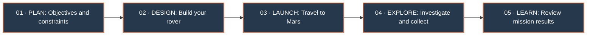

  

<h1 align="center">2Mars</h1>

<strong>Every decision shapes the mission.</strong>

  An educational Mars mission design and management game by Team SpaceNuts.
   
  Built for the <strong>NASA Space Apps Challenge 2026</strong>.

  
  
  
  

---

## Your mission starts on Earth

2Mars puts players in the role of a Mars mission team. Plan an expedition, make engineering trade-offs, configure a rover, launch it, and manage scientific operations on the Martian surface. Every choice has consequences for what the mission can achieve.

**[Play the web version →](https://2mars.vercel.app)**

## A look inside the rover workshop

These are original in-game component assets from V4:

  
  
  
  

## Explore 2Mars

| Mission planning | Rover engineering | Mars operations |
|---|---|---|
| Set priorities, select a launch window, destination and mission profile. | Balance mass, budget, power, mobility and scientific capability across a rover build. | Explore Jezero Crater, investigate targets, collect samples, manage data and transmit results. |

- **Two ways to play:** Campaign and Sandbox.
- **Cooperative play:** local two-player mode with complementary mission roles.
- **Bilingual experience:** English and Spanish.
- **Science Library:** NASA/JPL references, real mission examples, and clear distinctions between facts and game abstractions.
- **Mission scope:** four campaign exploration areas, around 30 rover component options, and seven primary science instruments.

## Project evidence and documentation

The official NASA Space Apps Project Submission is the project's public-facing entry. This repository complements it with implementation evidence, technical detail and transparent documentation rather than duplicating the submission.

- [Challenge alignment](evidence/CHALLENGE_ALIGNMENT.md) — where mission-design activities appear in the implemented game.
- [Educational design](evidence/EDUCATIONAL_DESIGN.md) — intended learning opportunities and their gameplay activities.
- [Mission walkthrough](evidence/MISSION_CASE_STUDY.md) — a reproducible route for inspecting a complete mission.
- [Test report](evidence/TEST_REPORT.md) — automated test instructions, coverage and evidence limits.
- [AI and asset attribution](evidence/AI_AND_ASSET_ATTRIBUTION.md) — team-confirmed tools and attribution checks.
- [Evidence index](evidence/README.md) — all supporting documentation in one place.

## Quick start

### Play online

Open **[2mars.vercel.app](https://2mars.vercel.app)** in a modern desktop browser.

### Run the project locally

1. Install **Godot Engine 4.7**.
2. Clone or download this repository.
3. In Godot, import `Game-versions/V4/project.godot`.
4. Press **F6** to run the current scene or **F5** to run the project.

No additional plugins or external runtime dependencies are required for the V4 project.

For controls, co-op roles, testing commands and the full mission walkthrough, see the **[V4 Game Guide](Game-versions/V4/README.md)**.

## Repository map

| Location | What belongs here |
|---|---|
| [`Game-versions/V4/`](Game-versions/V4/) | **Current version.** Main Godot project, assets, scripts, scenes, tests and V4 documentation. |
| [`Game-versions/V3/`](Game-versions/V3/) | Previous playable development version, retained for project history. |
| [`Game-versions/V1/`](Game-versions/V1/) | Early prototype and original project files. |
| [`research/`](research/) | NASA/JPL references, mission-planning research and source inventories. |
| [`assets/`](assets/) | Repository-level visual assets used by the documentation. |
| [`Game-versions/V4/docs/`](Game-versions/V4/docs/) | Technical handoff, requirements, science traceability, resource audit and submission references. |

Start with the **[repository guide](Game-versions/README.md)** for version history and navigation.

## Science and sources

NASA and NASA/JPL documentation informs the scientific objectives, rover systems, instruments, sample investigations, mobility and communications represented in 2Mars. The in-game Science Library connects selected sources to specific gameplay decisions.

- [NASA resources used in 2Mars](research/NASA_RESOURCES_USED.md)
- [V4 science traceability](Game-versions/V4/docs/SCIENCE_TRACEABILITY.md)
- [V4 resource and attribution audit](Game-versions/V4/docs/RESOURCE_AUDIT.md)
- [Research index](research/README.md)

**Scientific scope:** 2Mars is an educational game, not a professional engineering tool or high-fidelity orbital simulator. NASA sources are used as research references; the game does not directly load NASA planetary datasets or reproduce a complete real-world astrodynamics model. Game parameters and fictional mission elements are distinguished from sourced facts.

## Built with

- **Godot Engine 4.7** and **GDScript** — game engine and gameplay.
- **GitHub** — version control and documentation.
- **Vercel** — web deployment.
- **Canva, Claude, ChatGPT, OpenAI Codex, Microsoft Copilot and Higgsfield** — used in different parts of the team's art direction, visual generation, coding assistance, asset workflow and animation production.

For a more detailed account of tools and attribution, consult [V4 Resource Audit](Game-versions/V4/docs/RESOURCE_AUDIT.md) and [Submission Resources](Game-versions/V4/docs/SUBMISSION_RESOURCES.md).

## Team

**Team SpaceNuts** · Panama

Created for the **NASA Space Apps Challenge 2026 — Space Mission Design Game**.

## Contributing

We welcome suggestions, bug reports and improvements to the documentation. Read the [contribution guidelines](CONTRIBUTING.md) before opening an issue or pull request.

## License

This repository is distributed under the [MIT License](LICENSE), unless a third-party asset or font specifies its own license. See the V4 resource audit for attribution details.

---

<strong>2Mars — Every decision shapes the mission.</strong>

Made by Team SpaceNuts · Panama

